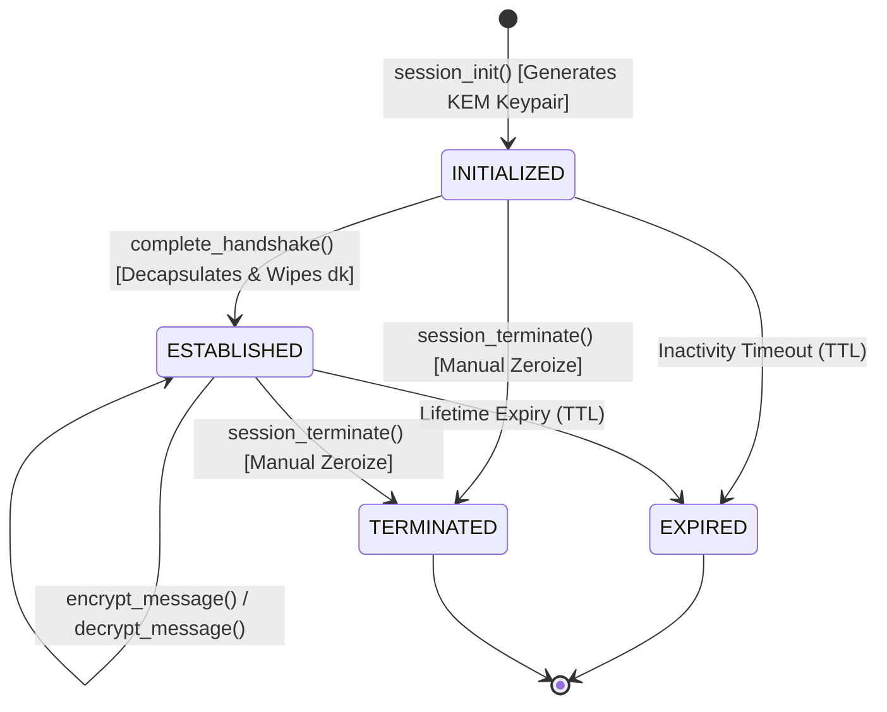
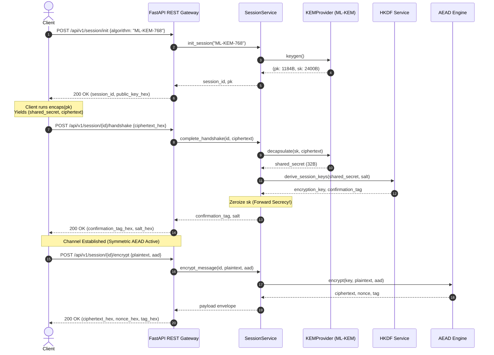

# PQC-Lab Architecture & Technical Design

## 1. Executive Summary

**PQC-Lab** is a reference architecture and practical engineering laboratory for **Post-Quantum Cryptography (PQC)**. It implements the **NIST FIPS 203 Module-Lattice-Based Key-Encapsulation Mechanism (ML-KEM)** combined with **RFC 5869 HKDF** key derivation and modern **Authenticated Encryption with Associated Data (AEAD)** ciphers (`AES-256-GCM` and `ChaCha20-Poly1305`).

The architecture provides a defense-in-depth model against **"Harvest Now, Decrypt Later" (HNDL)** adversarial attacks, ensuring that ciphertexts captured today remain safe against future cryptanalytically relevant quantum computers (CRQCs).

---

## 2. Cryptographic Envelope Pipeline

PQC-Lab utilizes a hybrid envelope construction:

```
[ Alice (Sender) ]                                  [ Bob (Recipient) ]
        |                                                   |
        |                  1. Public Key (ek)               |
        |<--------------------------------------------------|  Bob generates (ek, dk)
        |                                                   |  via ML-KEM keygen
        |                                                   |
  Alice generates                                           |
  (shared_secret, c)                                        |
  via ML-KEM encaps                                         |
        |                  2. Ciphertext (c)                |
        |-------------------------------------------------->|  Bob decapsulates (dk, c)
        |                                                   |  recovers shared_secret
        |                                                   |  Bob securely wipes dk!
        v                                                   v
   [ HKDF-Extract & Expand ]                           [ HKDF-Extract & Expand ]
        |                                                   |
        +---> Session Key (256-bit) <-----------------------+
        +---> Confirmation Tag <----------------------------+
        |                                                   |
        |           3. AEAD Encrypted Payload (AES-GCM)     |
        |<=================================================>|
```

### Protocol Steps:
1. **Asymmetric Key Encapsulation (ML-KEM)**:
   - Bob generates encapsulation key $ek$ and decapsulation key $dk$.
   - Alice encapsulates against $ek$, yielding a 32-byte uniformly random shared secret $SS$ and ciphertext $c$.
   - Bob receives $c$ and decapsulates with $dk$ to recover $SS$.
2. **Key Derivation (RFC 5869 HKDF)**:
   - Both parties pass $SS$ into HKDF along with a cryptographically random salt and domain-separated context information (`info = "enc:pqc-session:<session_id>"`).
   - Output produces a 256-bit symmetric key ($K_{sym}$) and a handshake confirmation tag ($T_{confirm}$).
3. **Symmetric Authenticated Channel (AEAD)**:
   - High-throughput, constant-time encryption using $K_{sym}$ via AES-256-GCM or ChaCha20-Poly1305.
   - Nonce freshness and Associated Data (AAD) authenticate protocol headers and sequence numbers.

---

## 3. Finite State Machine (FSM)

Session lifecycles are governed by an atomic state machine:



### State Definitions:
- **`INITIALIZED`**: Keypair generated; public key exposed to client; private decapsulation key held in ephemeral memory.
- **`ESTABLISHED`**: Handshake confirmed; shared symmetric key derived; **private key zeroized from memory** to guarantee forward secrecy.
- **`EXPIRED`**: Session exceeded configured TTL; all key material destroyed.
- **`TERMINATED`**: Explicitly destroyed by caller; memory zeroized.

---

## 4. Module Decomposition

```
app/
├── config.py                # Environment-driven Pydantic configuration
├── crypto/
│   ├── kem.py               # Abstract KEMProvider, ML-KEM-512/768/1024 & X25519
│   ├── kdf.py               # RFC 5869 HKDF extract/expand & session derivation
│   └── aead.py              # AES-256-GCM & ChaCha20-Poly1305 authenticated ciphers
├── services/
│   └── session_service.py   # Thread-safe session store, FSM, and memory zeroization
└── api/
    ├── routes.py            # FastAPI REST endpoints
    └── schemas.py           # Strict Pydantic validation schemas
```

### Key Components:

1. **`app.crypto.kem`**:
   - `KEMProvider`: Polymorphic interface defining `keygen()`, `encapsulate()`, and `decapsulate()`.
   - `MLKEM512Provider`, `MLKEM768Provider`, `MLKEM1024Provider`: Compliant implementations of NIST FIPS 203.
   - `X25519KEMProvider`: Classical Diffie-Hellman baseline for benchmark comparisons.

2. **`app.crypto.kdf`**:
   - Implements RFC 5869 HMAC-based Extract-and-Expand Key Derivation Function.
   - Distinct contextual domain separation prevents cross-protocol key leakage.

3. **`app.crypto.aead`**:
   - Supports 256-bit symmetric security with authenticated associated data (AAD).
   - Strict 16-byte tag integrity checks preventing chosen-ciphertext attacks (IND-CCA2).

4. **`app.services.session_service`**:
   - Thread-safe in-memory session registry with `threading.RLock()`.
   - Nonce reuse detection and message sequencing.
   - Secure memory zeroization via `bytearray` overwrite.

---

## 5. Sequence Diagram: End-to-End Session


